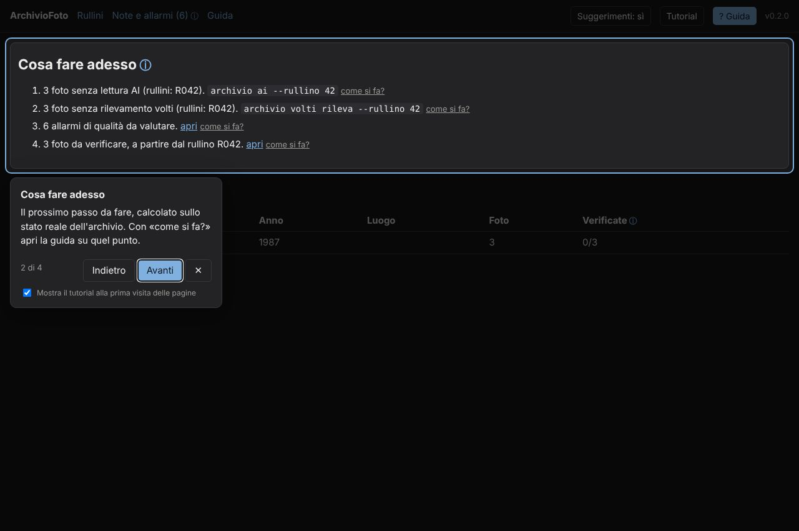
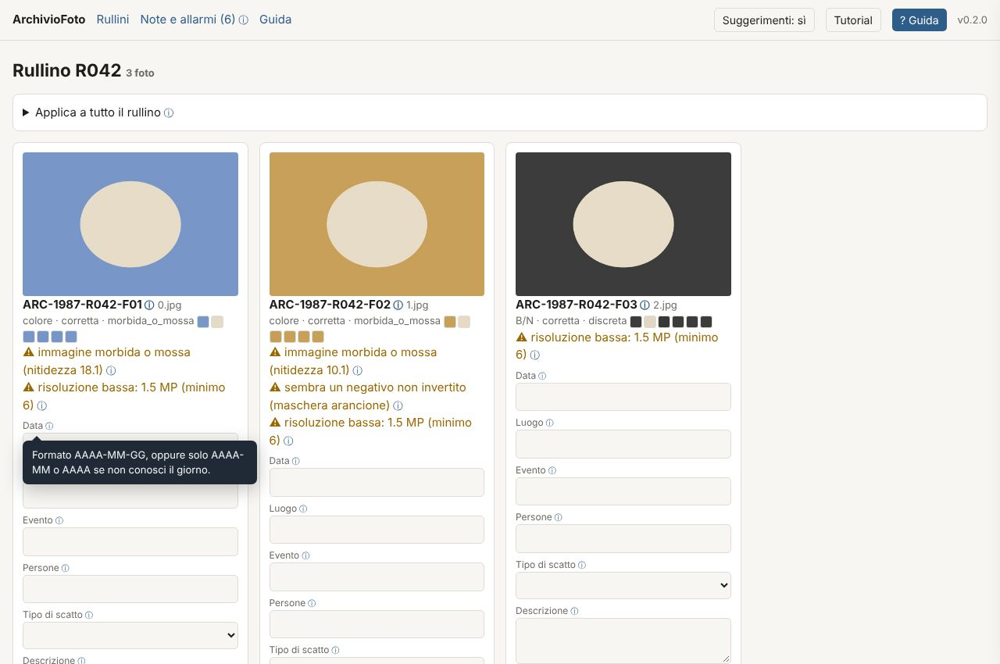
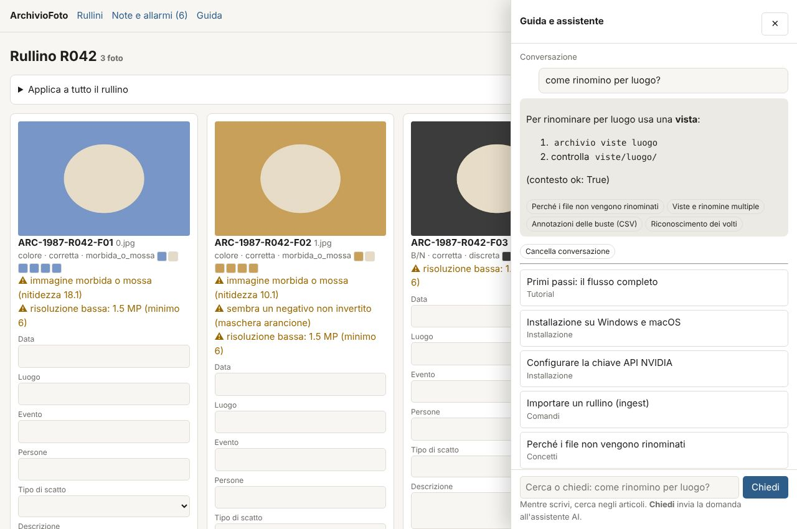

# ArchivioFoto

Strumento per digitalizzare e catalogare un archivio di negativi scansionati. Funziona su **Windows, macOS e Linux**.
Versione e novità: [CHANGELOG.md](CHANGELOG.md) oppure `archivio versione --log`.

## Principi
- **ID immutabile**: ogni master si chiama `ARC-ANNO-Rrrr-Fff` (archivio-anno-rullino-fotogramma), resta in sola lettura e non viene mai rinominato. È il legame con il negativo fisico.
- **Dati con provenienza**: `dati/<id>.json` separa `fisico` (busta, pellicola), `umano` (annotazioni e correzioni), `tecnico` (misurato), `ai` (dedotto) e `volti`. I dati umani hanno sempre la precedenza.
- **Rinomine = viste**: le diverse "rinomine" sono cartelle di link in `viste/`, generate da uno schema e rigenerabili quando vuoi.
- **Standard aperti**: i sidecar XMP/IPTC rendono i dati leggibili anche da Lightroom, digiKam e Bridge.
- **Niente fallisce in silenzio**: ogni errore, avviso o problema di qualità finisce nelle **note** (`archivio note`).

> Una scansione non contiene l'EXIF dello scatto originale (tempo, diaframma, data). Quei dati arrivano dalle buste o dalle tue correzioni, non dal file.

## Installazione
**[INSTALLAZIONE.md](INSTALLAZIONE.md)**. In breve: scarica [ArchivioFoto-Windows.zip](https://github.com/Vincio84n/consuelnza/releases/download/archiviofoto/ArchivioFoto-Windows.zip) o [ArchivioFoto-macOS.zip](https://github.com/Vincio84n/consuelnza/releases/download/archiviofoto/ArchivioFoto-macOS.zip), estrai e fai doppio clic. Non serve Python.

## I file dell'archivio
| File | Cosa contiene | Chi lo scrive |
|---|---|---|
| `CONFIGURAZIONE.md` | tutte le scelte: motori NVIDIA, soglie, porta, viste… | tu (a mano o da Impostazioni) |
| `ISTRUZIONI.md` | contesto, regole e vocabolario per l'AI | tu |
| `REGISTRO.md` | diario di ogni operazione e modifica, con esito e versione | il programma (solo aggiunte) |
| `note.json` | errori e allarmi aperti/chiusi | il programma e tu |
| `master/`, `dati/` | foto originali e schede JSON | il programma |

| `CHIAVE.md` (facoltativo) | la chiave API in chiaro, se scegli di non usare il portachiavi | tu (da Impostazioni o `archivio chiave imposta --file`) |

La **chiave API** sta nel portachiavi del sistema oppure in `CHIAVE.md`. Mai in CONFIGURAZIONE.md, nel Registro o su GitHub: `CHIAVE.md` è escluso da Git e dagli ZIP di rilascio.

**Motore predefinito**: `nvidia/nemotron-3-ultra-550b-a55b` per foto e assistente, con riserva di visione `nvidia/nemotron-nano-12b-v2-vl`.

## Configurazione dei motori
```bash
archivio chiave imposta                 # chiede la chiave nvapi-... senza mostrarla
archivio motori elenca                  # modelli disponibili con la tua chiave
archivio motori usa visione meta/llama-3.2-11b-vision-instruct
archivio motori usa riserva nvidia/nemotron-nano-12b-v2-vl
archivio motori prova                   # chiamata reale: esito e tempi
archivio config                         # tutte le impostazioni
archivio config imposta soglia_somiglianza=0.4
archivio istruzioni --prompt            # cosa viene aggiunto alla richiesta AI
archivio registro -n 20
archivio aggiorna
```

## Flusso per rullino
```bash
archivio init D:\Archivio            # oppure /Users/me/Archivio
cd D:\Archivio
archivio ingest E:\scansioni\busta12 --rullino 42 --anno 1987 --busta B12 --pellicola "Kodak Gold 200"
archivio analizza --rullino 42       # dati tecnici + allarmi di qualità + impronta visiva
archivio ai --rullino 42             # segue ISTRUZIONI.md; --obsolete rilegge le foto con istruzioni vecchie
archivio volti rileva --rullino 42
archivio annota buste.csv            # annotazioni delle buste
archivio revisione                   # si apre il browser: controlli e correggi rullino per rullino
archivio xmp
archivio viste cronologico
archivio note                        # cosa non ha funzionato
archivio stato
```

## Note e allarmi
Un unico registro (`note.json`) per tutto ciò che va guardato:

| Livello | Esempi |
|---|---|
| `errore` | API non raggiungibile o chiave errata, file illeggibile, master mancante o corrotto |
| `attenzione` | doppioni, righe CSV senza riscontro, chiave assente, disco quasi pieno, link non supportati |
| `qualita` | foto sotto/sovraesposta, mossa, luci bruciate, negativo non invertito, risoluzione bassa |
| `nota` | note tue, anche legate a una foto |

```bash
archivio note                                  # aperte
archivio note --livello errore
archivio note --tutte                          # anche quelle chiuse
archivio note aggiungi "busta 12 rovinata" --id ARC-1987-R042-F07
archivio note risolvi 4 7
archivio verifica --hash --rete                # controllo completo: ambiente, master, integrità, API
```
Una nota identica ancora aperta non viene duplicata: aumenta il contatore delle ripetizioni. Le note si gestiscono anche dalla pagina "Note e allarmi" dell'interfaccia di revisione.

## Webapp di revisione, guida e assistente
`archivio revisione` avvia un piccolo server locale (`http://127.0.0.1:8765`, raggiungibile solo dal tuo computer) e apre il browser.
- **Cosa fare adesso**: i prossimi passi, calcolati sullo stato dell'archivio, con il comando da eseguire.
- **Rullini**: per ogni foto miniatura, dati tecnici con palette, lettura AI, volti e allarmi. Puoi correggere i campi, applicarli a tutto il rullino e spuntare "verificata".
- **Suggerimenti** (ⓘ): finestre di spiegazione al passaggio del mouse, disattivabili dal pulsante in alto.
- **Tutorial**: visita guidata di ogni pagina. Parte da sola alla prima visita e si può disattivare.
- **? Guida** (tasto `/`): motore di ricerca negli articoli mentre scrivi, che funziona anche offline. **Chiedi** apre una conversazione con l'assistente AI, che risponde con i comandi da usare basandosi sulla guida e sullo stato del tuo archivio. Usa `ai.modello_testo` e richiede la chiave API.

| Tutorial | Suggerimenti | Guida e assistente |
|---|---|---|
|  |  |  |

*Immagini di prova: le foto sono sintetiche e la risposta dell'assistente viene da un server di test.*

## Volti
Elaborati in locale con OpenCV: le foto non vengono inviate all'esterno. Alla prima esecuzione scarica i modelli (~40 MB) nella cartella `modelli/`.
```bash
archivio volti rileva
archivio volti raggruppa             # raggruppa i volti simili: G001, G002...
archivio volti anteprima             # ritagli in viste/_volti/G001/... per riconoscerli
archivio volti nomina G001 "Mario Rossi"
archivio volti raggruppa             # rieseguilo dopo nuovi rilevamenti: i nomi restano
```
Se due persone finiscono nello stesso gruppo, o una persona in due gruppi, regola `volti.soglia_somiglianza` in `archivio.json` (più alta = gruppi più severi).

## Annotazioni delle buste (CSV)
Separatore `;` o `,`. `rullino` è obbligatorio. Se manca `fotogramma`, la riga vale per tutto il rullino.
```
rullino;fotogramma;data;luogo;evento;persone;note
42;;1987-08-15;Matera;Ferragosto;Mario Rossi, Anna;
42;7;;Bari;;;foto sul porto
```

## Viste (rinomina multipla)
Preset: `cronologico`, `luogo`, `tipologia`, `persone`, `fisico`, `tecnico`. In alternativa, uno schema libero:
```bash
archivio viste "{anno}/{tipo}/{data}_{luogo}_{id}" --nome per-tipo
```
Campi: `id anno data rullino fotogramma busta formato pellicola luogo evento persone tipo ambiente epoca soggetto colore esposizione nitidezza`.
Su dischi NTFS e APFS le viste sono hard link e non occupano spazio. Su FAT/exFAT (chiavette, alcuni dischi esterni) diventano copie, e lo trovi segnalato nelle note. `--modo copia` crea copie vere, ad esempio per consegnare una selezione.

## Ricerca, somiglianza, esportazione
```bash
archivio cerca chiesa matera
archivio simili ARC-1987-R042-F07     # foto con composizione e colori simili
archivio doppioni                     # scansioni doppie: finiscono nelle note
archivio esporta indice.csv           # si apre direttamente in Excel
```

## Motore AI
Va bene qualsiasi API **OpenAI-compatibile con supporto immagini**. Configurala in `archivio.json`:
```json
"ai": {"base_url": "https://integrate.api.nvidia.com/v1", "modello": "nvidia/nemotron-nano-12b-v2-vl", "chiave_env": "NVIDIA_API_KEY"}
```
Il modello deve essere **di visione**: i modelli Nemotron 3 solo testo (Nano, Super, Ultra) non leggono le immagini: Nemotron 3 Ultra è il modello predefinito per l'assistente (`modello_testo`). Per lavorare in locale, senza inviare le foto all'esterno, usa ad esempio Ollama (`http://localhost:11434/v1`) con un modello VL. Per provare un modello su un rullino: `archivio ai --rullino 42 --forza --modello <nome>`. Dopo 3 errori consecutivi il comando si ferma, per non consumare richieste.

## Sviluppo
```bash
pip install -e ".[volti,test]"
python -m pytest tests
```
La CI (GitHub Actions, workflow "ArchivioFoto") esegue i test su Windows, macOS e Linux. Ad ogni rilascio aggiorna `__version__` in `archiviofoto/__init__.py` e `CHANGELOG.md`.
